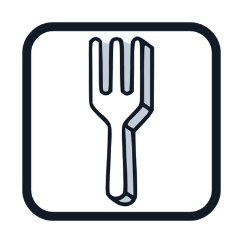

# Polyfork for AI agents

Free low-poly 3D models and kits, built to be used by agents. [Polyfork](https://polyfork.dev)
has 3,000+ models (props, buildings, vehicles, characters, animals, terrain, whole themed
kits), each with its real-world size in metres, its palette and its triangle count. Most are
**programs with sliders**: one `createAsset({...})` call gives a different shape, colourway,
season or set of parts. Every low poly model is free.

This repo connects Polyfork to your assistant: an MCP server (search, inspect, remix, preview,
kits, terrain) plus a skill that teaches the agent how to place models so the scene looks
right (real scale, ground at y = 0, kits, lighting, credit).

## Install

| App | How |
|---|---|
| **Claude Code** | `/plugin marketplace add lucas-martinic/polyfork-agents` then `/plugin install polyfork@polyfork` |
| **Claude.ai / Claude Desktop** | Customize > Connectors > Add custom connector, URL `https://polyfork.dev/mcp/account` (sign in) or `https://polyfork.dev/mcp` (no account) |
| **ChatGPT** | With developer mode on, add a custom app with URL `https://polyfork.dev/mcp/account` (OAuth) |
| **Codex** | `codex mcp add polyfork --url https://polyfork.dev/mcp`, or the plugin: `codex plugin marketplace add lucas-martinic/polyfork-agents` then `/plugins` |
| **Gemini CLI** | `gemini extensions install https://github.com/lucas-martinic/polyfork-agents` |
| **Antigravity CLI** | `agy plugin install https://github.com/lucas-martinic/polyfork-agents` |
| **Cursor** | [Add to Cursor](cursor://anysphere.cursor-deeplink/mcp/install?name=polyfork&config=eyJ1cmwiOiJodHRwczovL3BvbHlmb3JrLmRldi9tY3AifQ%3D%3D) |
| **VS Code** | `code --add-mcp '{"name":"polyfork","type":"http","url":"https://polyfork.dev/mcp"}'` |
| **Anything else** | Streamable HTTP MCP server at `https://polyfork.dev/mcp` |

More clients and the API-key variants: https://polyfork.dev/agents

### Signed in or anonymous?

- `https://polyfork.dev/mcp` works with no account: search, inspect and load every free model.
- `https://polyfork.dev/mcp/account` signs you in (OAuth, Google or email). The app gets a key
  on your account, so it sees your plan, a bigger remix budget, per-model and whole-kit zips
  and, on Pro, the HD editions. Remove it any time on https://polyfork.dev/account.

### The skill on its own

`plugins/polyfork/skills/polyfork/SKILL.md` is a standard Agent Skill.

- **Claude.ai:** upload https://polyfork.dev/polyfork-skill.zip under Customize > Skills.
- **Codex:** copy the `polyfork` folder to `~/.agents/skills/`.
- **Other agents:** it works as plain instructions too.

## What the agent can do

- `search_assets`, `get_asset`: find models and read their size, palette, rig and downloads. In
  Claude and ChatGPT the result renders as a live 3D card with the model's own sliders.
- `find_matching`: what goes with a model (same kit, palette, scale).
- `get_variant`: plain words to a ready `createAsset()` call ("oak cask, autumn").
- `list_kits`, `get_kit`: whole themed sets and the few lines that build and light a place.
- `get_terrain`: ground height, slope and flat building sites for a kit's landscape.
- `preview_scene`: a page the user can open and orbit.
- `report_need`: request a model the catalogue lacks.

## Licence

The connector code in this repo is MIT. Free models' mesh files are CC BY 4.0 (credit
`<Title> by Polyfork (https://polyfork.dev/asset/<id>), CC BY 4.0`) or the Polyfork licence;
the `.mjs` programs and HD editions are under the Polyfork licence. See
https://polyfork.dev/licensing.
